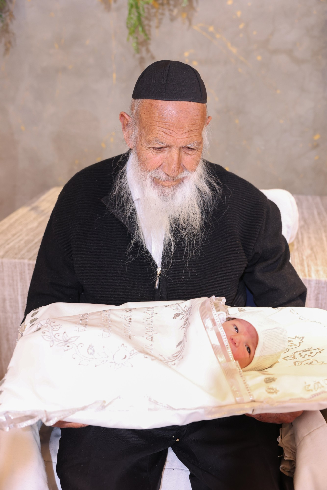

---
# נכתב עם בעל הפרויקט 2026-10-29, על סבו חכם רפאל הכהן זצ"ל (בנו של חכם אפרים הכהן).
# לא מהארכיון (אין archiveId).
# עובדות: סופר סת"ם ומלמד תשב"ר, נפטר ו' בשבט תשפ"ה בגיל 86 (בחדרי חרדים, 4.2.2025).
# הברית של יצחק (בן בעל הפרויקט) – כחודשיים וחצי לפני הפטירה, לפי גיל יצחק; לאמת.
# המשפט של אמא ("הוא בא בשבילי. להגיד לי תודה.") – מפיה, כפי שמסר בעל הפרויקט.
# נוסח משולב מהשכתוב של בעל הפרויקט. פרסום: 29.10.2026 בשעה 18:25 שעון ישראל (שעת ההעלאה בפועל, לפי הוראת בעל הפרויקט).
title: "כל בוקר, תפילין"
section: yoman
topic: family
cover: ../../assets/covers/kol-boker-tefillin.jpg
coverAlt: "זוג תפילין שחורות על שולחן עץ ישן ליד חלון מקושת באור בוקר, הרצועה מגולגלת סביבן; ברקע קולמוס נוצה, קלף, צנצנת דיו ושקית קטיפה כחולה"
date: 2026-10-29T16:25:00Z
excerpt: "כל בוקר, בבית החולים הרצוג, אמא הניחה לסבא תפילין. הוא כתב תפילין כל חייו."
hook: "מה מחזירים למי שנתן לנו כל בוקר, שנים?"
tags: [משפחה, כיבוד הורים, תפילין, סבא, ברית, תודה]
source: "סיפור אישי מאת אפרים עטייה."
---

כל בוקר, בבית החולים הרצוג בירושלים, אמא הניחה לסבא תפילין.

היד שלו כבר הייתה כבדה ורפויה. 
והיא אחזה בה בעדינות. 
כרכה את הרצועה, סיבוב אחרי סיבוב, 
ועמדה לידו כשהוא לחש "שמע ישראל".

הוא היה סופר סת"ם. 
כל חייו כתב תפילין, אות אחרי אות, ליד שולחן העץ בבית.

"וקשרתם לאות על ידך". 
רבבות פעמים הוא כתב את המילים האלה. 
קשר אלפי יהודים לקדוש ברוך הוא.

*ועכשיו, הידיים שלה קשרו אותו.*

כל בוקר.

ובבוקר אחד, הוא לא נשאר בחדר.

לאירועים הוא כבר מזמן לא יצא. 
וגם באותו בוקר הוא הרגיש חלש מאוד. 
אבל לברית של הבן שלי, *יצחק*, הוא לא היה מוכן לוותר.

האולם היה ממש ליד בית החולים. 
אמא הביאה אותו בכיסא גלגלים.

ארבעה דורות סביב שולחן אחד.

<figure class="inline-photo">

<figcaption>חכם רפאל הכהן זצ"ל, עם הנין יצחק, בבוקר הברית</figcaption>

</figure>

והוא חייך. 
כל הברית הוא חייך. 
לכל מי שניגש, לכל מי שלחץ את ידו.

כאילו שכח מבית החולים. 
כאילו חזר הביתה.

חודשיים וחצי אחר כך, הוא נפטר. 
*זו הייתה השמחה האחרונה שהוא זכה להיות בה.*

אמא אומרת את זה עד היום:

> "הוא לא בא בשביל הברית. 
> הוא בא בשבילי. 
> להגיד לי תודה."

אף אחד לא תולה שלט שאומר שזו הפעם האחרונה. 
את זה מבינים רק אחר כך.

אמא לימדה אותי, בלי מילה אחת של הטפה, 
איך מכבדים הורה. 
כל בוקר.

*עכשיו זה התור שלי איתה.*

שאלה לדרך
מה הדבר הקטן שאני יכול לתת להורים שלי כבר היום?

מאמין בך, אפרים עטייה

